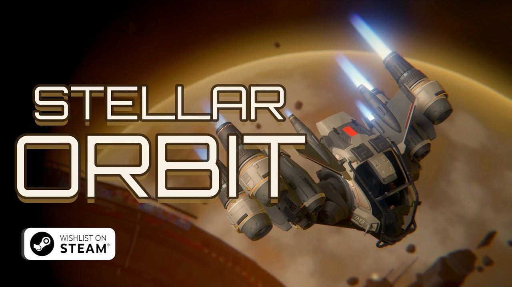
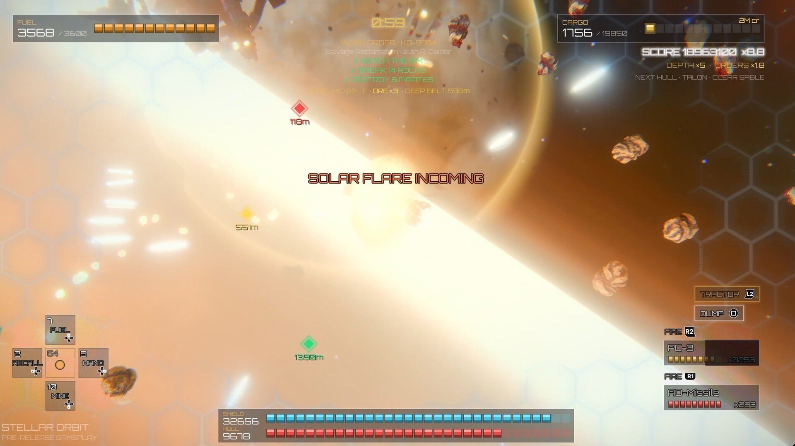
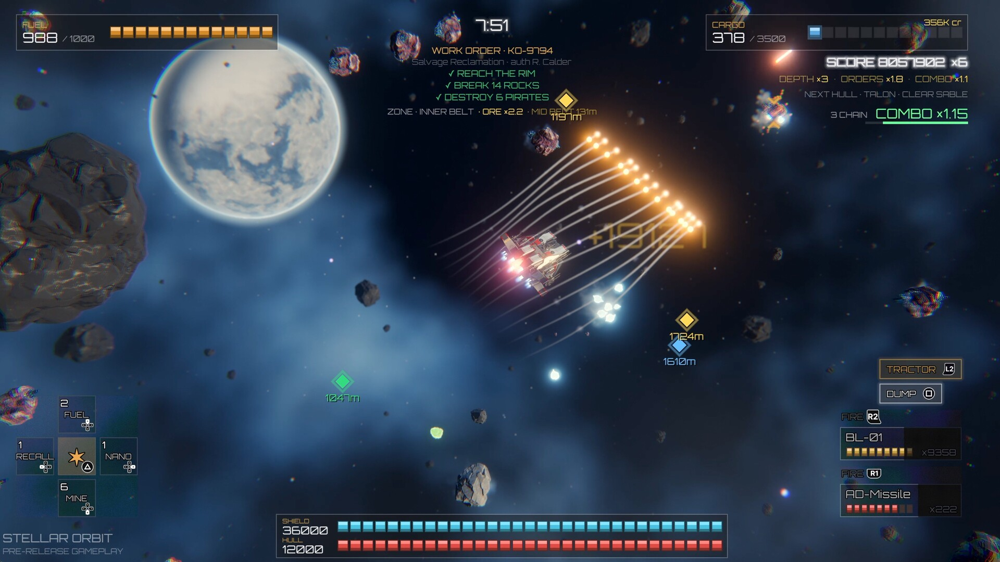
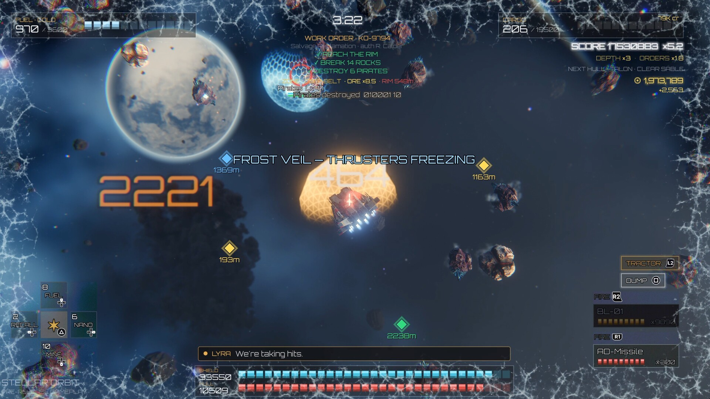
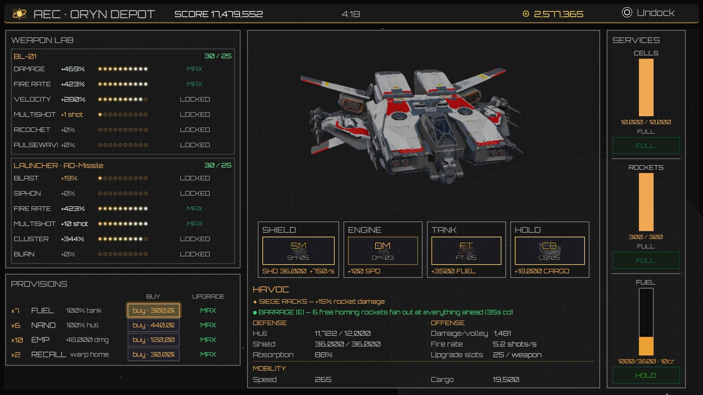

# Stellar Orbit

> Mine deeper than your fuel can carry you, while solar flares scramble your instruments.

Stellar Orbit is a top-down mining-survival score chase for PC. Strip an ore belt with the same guns that fight the pirate swarm. Race your fuel home. Push each run deeper toward a dying star.

- **Steam:** [Wishlist Stellar Orbit](https://store.steampowered.com/app/4998980/Stellar_Orbit/) (coming soon)
- **Free demo:** [Steam](https://store.steampowered.com/app/4998980/Stellar_Orbit/) (Download Demo button) or [itch.io](https://stellar-orbit.itch.io/stellar-orbit)
- **Steam Next Fest:** the demo is part of Steam Next Fest, October 2026.
- **Trailer:** [watch on YouTube](https://www.youtube.com/watch?v=CeCdy9WPNNw)
- **Platforms:** Windows, macOS, Linux / SteamOS.

---

## How it plays

1. You start at a station in the middle of an ore belt.
2. Fly out and shoot rocks to mine them. There is no drill: your laser and rockets do the mining.
3. Pull the ore shards in with your tractor beam.
4. Thrust burns fuel, and the belt has no refuelling. Ore gets richer and pirates get worse the farther you go.
5. Dock inside the station's buoy ring to sell your hold, refit, and refuel.
6. Run dry or get destroyed, and the run is over. Your score is how rich, how deep, and how long you lasted.

## Features

- **The guns are the drill.** A hold-to-fire laser and rockets: tap to dumb-fire, hold to paint a homing lock.
- **Solar flares** sweep the system on a cycle. They scramble your HUD and shear the screen.
- **Seven worlds** from the safe rim to the dying star: Korrath, Sable, Oryn, Threll, Caldris, Vyne, and Morsk.
- **A signature hazard on each world.** Ion storms lock your shields. An ember forge cooks the hull. A frost veil freezes your thrusters. A micro black hole throws your ship across the map.
- **A pirate swarm** that grows with depth and run time. Boss encounters, and a pirate bastion to destroy on Morsk.
- **Seven hulls.** Each has a signature stat, a passive perk, and one active ability.
- **Upgrade ladders** for shield, engine, tank, and hold. Tune your laser and rockets in the Weapon Lab.
- **Fully voiced.** Your ship AI, Company dispatch, and pirate chatter, all with on-screen text.
- **No save to babysit.** Each run stands alone. Best scores and unlocks carry over.
- **Steam Achievements, Leaderboards, and Cloud** in the full game on Steam.
- **Full controller support**, including DualSense.

## Screenshots

| | |
|---|---|
|  |  |
|  |  |

## The demo

- Play Korrath, the first world, on a fixed 15-minute shift.
- A short guided tour walks you through your first run.
- Free on Steam and on itch.io. The itch.io builds run without Steam.

## Languages

English, Finnish, German, French, Spanish, and Simplified Chinese. Interface, subtitles, and voice.

## Accessibility

- Text size: Normal or Large
- Colourblind filter: Protanopia, Deuteranopia, Tritanopia
- Reduce motion, reduce flashing, and a screen shake toggle
- Adjustable HUD opacity and damage numbers
- Voice and on-screen text toggles for each speaker
- Separate volume sliders for music, effects, and voice
- Rebindable keyboard and mouse. Remap gamepads through Steam Input.
- Adjustable controller rumble and trigger force

## System requirements (minimum)

| | Windows | macOS | Linux / SteamOS |
|---|---|---|---|
| OS | Windows 10 64-bit | macOS 11 Big Sur | Ubuntu 20.04 / SteamOS 3 |
| CPU | Dual-core 2.5 GHz | Apple M1 or Intel Core i5 | x86-64 dual-core 2.0 GHz |
| Memory | 4 GB | 4 GB | 4 GB |
| Graphics | Vulkan 1.0, GTX 660 / RX 460, 2 GB VRAM | Apple M1 GPU or Metal-capable GPU | Vulkan 1.2, 2 GB VRAM |
| Storage | 2 GB | 2 GB | 2 GB |

Recommended specs are on the [Steam page](https://store.steampowered.com/app/4998980/Stellar_Orbit/).

## AI disclosure

The voice lines, non-English localization, and store art are made with generative AI tools.

## Privacy

Stellar Orbit is a single-player game that works offline.

- No analytics. No ads. No tracking.
- No account needed beyond Steam itself.
- On Steam, your achievements, stats, and leaderboard scores go to Steam. Steam Cloud syncs your unlocks and settings.
- Crash reports stay on your computer. You decide whether to email one to support.

Full policy: [privacy.md](privacy.md)

## Support

Found a bug or have feedback? Email **support@playstellarorbit.com**, or post in the [Steam discussions](https://steamcommunity.com/app/4998980/discussions/).

To send a crash report: open **Settings → Profile → Generate report** in the game. Attach the file to your email.

## Links

- [Steam store page](https://store.steampowered.com/app/4998980/Stellar_Orbit/)
- [itch.io demo](https://stellar-orbit.itch.io/stellar-orbit)
- [YouTube](https://www.youtube.com/@playstellarorbit)

## License

© 2026 Juha Ylitalo. All rights reserved.

Built with [Godot Engine](https://godotengine.org) and [GodotSteam](https://godotsteam.com). Uses the [Orbitron](https://fonts.google.com/specimen/Orbitron) font (SIL Open Font License).
